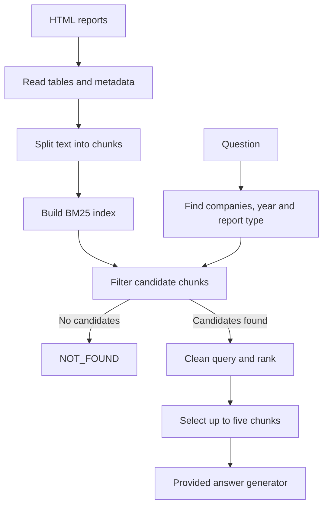

## Homework 4 solution

### 1. My pipeline



I use BeautifulSoup to read the HTML reports. The program extracts the company, fiscal year and document type from each report.

For tables, I keep the title and connect each value with its row and column labels. For example:

```text
Revenue | 2025: 100.5 | 2024: 95.2
```

I use the text splitter from Tutorial 7. The chunk size is 1,000 characters, with an overlap of 200 characters. Each chunk keeps its document metadata. Table conversion and chunking do not use an LLM.

I use BM25 instead of embeddings or a vector database. For question parsing, I use the provided `make_llm()` to find companies and document type. A regular expression finds the year. Parsing results are cached.

The retriever filters chunks by company, report type and year coverage. A year's data may appear in that year's annual report or the next year's report.

Before ranking, I remove company names and common question words from the search query. This helps BM25 focus on the requested financial metric.

For comparisons, I take turns selecting chunks from each company. The retriever returns at most five original chunks. It returns an empty list when there are no matching candidates.

### 2. Ablation study

I tested five versions on the same public set of 40 documents and 60 questions. Each version adds one component to the previous version.

| Version | Change |
|---|---|
| B0 | Plain HTML text, metadata, text splitting and whole-corpus BM25 top-five retrieval |
| V1 | Add table-to-text conversion |
| V2 | Add question parsing and metadata filtering |
| V3 | Select evidence separately for each company |
| V4 | Remove company words and common question words before ranking |

B0 uses lower-case whitespace tokens. It does not parse questions or actively reject them.

Recall@5 measures whether all required evidence is found for an answerable question. Reject rate measures how often the retriever returns an empty list for an unanswerable question.

| Version | Recall@5 | Answer accuracy | Reject rate | Time (seconds) | Estimated cost (USD) |
|---|---:|---:|---:|---:|---:|
| B0 | 26.1% | 43.3% | 0.0% | 7.0 | 0.0130 |
| V1 | 28.3% | 43.3% | 0.0% | 7.4 | 0.0128 |
| V2 | 60.9% | 70.0% | 71.4% | 70.9 | 0.0123 |
| V3 | 60.9% | 70.0% | 71.4% | 68.8 | 0.0124 |
| V4 | 100.0% | 100.0% | 71.4% | 70.9 | 0.0148 |

Cost includes my model calls and the generator's calls. All versions returned chunks for every answerable question. Results and logs were saved for each version.

### 3. What helped?

**V1: Table conversion**

Recall improved slightly, but answer accuracy did not change. Table-question accuracy fell from 18.2% to 9.1%. Clearer table text alone did not solve the ranking problem. Changes to the text can also affect chunk boundaries and BM25 scores.

**V2: Metadata filtering**

This change helped greatly. Recall increased to 60.9%, and answer accuracy reached 70.0%. Question parsing was 100% correct on the public set. Filtering removed many passages about unrelated companies or reports.

**V3: Separate company selection**

Comparison accuracy increased from 25.0% to 33.3%, but comparison recall stayed at 16.7%. Overall accuracy did not change. Selecting passages from both companies was not enough: the passages also needed to contain the correct facts.

**V4: Query cleaning**

This change gave the largest improvement. Recall and answer accuracy both reached 100%. Company names were already used for filtering. Removing them from ranking helped the search focus on terms such as “net income”.

### 4. Error analysis

One V3 question compared the FY2024 net income of Kestrel Semiconductor and Halcyon Freight.

The retrieved files were relevant annual reports, but the selected passages did not contain both required figures. The generator answered `NOT_FOUND`.

Company names and common question words affected the ranking. Some selected passages were company introductions or other unrelated sections. V4 cleaned the query and focused on “net income”. It then found the required evidence.

### 5. Limitations

The final retriever rejected 10 of the 14 unanswerable questions. For the other four, it returned passages, but the generator correctly answered `NOT_FOUND`.

This is why answer accuracy was 100%, while Task 3 received 7.14 out of 10 points.

The current rejection method mainly relies on metadata filtering. It does not fully check whether a requested metric is disclosed. A future improvement could check evidence sufficiency, while avoiding rejection of answerable questions.

V4 received 72.14 out of 75 automatic points on the public set. Performance on the private set may be different.
