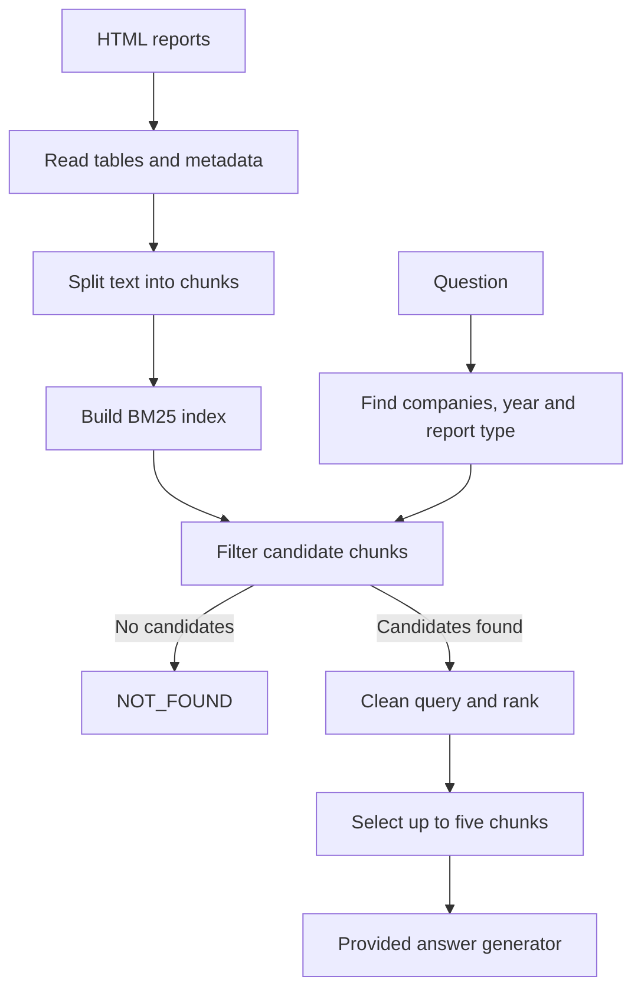

## Homework 4 solution

### 1. My pipeline



I use BeautifulSoup to read the HTML reports. The program extracts the company, fiscal year and document type from each report.

For tables, I keep the title and connect each value with its row and column labels. For example:

```text
Revenue | 2025: 100.5 | 2024: 95.2
```

I used the text splitter from Tutorial 7 to cut documents into 1000-character chunks, with a 200-character overlap. Each chunk keeps its metadata. I didn't use the LLM for parsing tables or chunking.

For searching, I used BM25 instead of vector embeddings. To parse the question, I used the provided make_llm() to extract the company names and document type. A simple regex gets the year, and I cached the results.

The retriever filters chunks by company, doc type, and year. Before ranking, I removed company names and common question words from the search query. This helps BM25 focus on the actual financial metric. For comparison questions, I take turns grabbing chunks from each company. It returns at most 5 raw chunks, or an empty list if nothing matches.

### 2. Ablation study

I tested five versions on the same public set of 40 documents and 60 questions. Each version adds one component to the previous version.

| Version | Change |
|---|---|
| B0 | Plain HTML text, metadata, text splitting and whole-corpus BM25 top-five retrieval |
| V1 | Add table-to-text conversion |
| V2 | Add question parsing and metadata filtering |
| V3 | Select evidence separately for each company |
| V4 | Remove company words and common question words before ranking |

| Version | Recall@5 | Answer accuracy | Reject rate | Time (seconds) | 
|---|---:|---:|---:|---:|
| B0 | 26.1% | 43.3% | 0.0% | 7.0 | 
| V1 | 28.3% | 43.3% | 0.0% | 7.4 |
| V2 | 60.9% | 70.0% | 71.4% | 70.9 |
| V3 | 60.9% | 70.0% | 71.4% | 68.8 |
| V4 | 100.0% | 100.0% | 71.4% | 70.9 |


### 3. What helped?

**V1: Table conversion**

Recall improved slightly, but answer accuracy did not change. Table-question accuracy fell from 18.2% to 9.1%. Clearer table text alone did not solve the ranking problem. 

**V2: Metadata filtering**

This change helped greatly. Recall increased to 60.9%, and answer accuracy reached 70.0%. Question parsing was 100% correct on the public set. 

**V3: Separate company selection**

Comparison accuracy increased from 25.0% to 33.3%, but comparison recall stayed at 16.7%. Overall accuracy did not change. Selecting passages from both companies was not enough: the passages also needed to contain the correct facts.

**V4: Query cleaning**

This change gave the largest improvement. Recall and answer accuracy both reached 100%. Company names were already used for filtering. Removing them from ranking helped the search focus on terms such as “net income”.

### 4. Error analysis

One V3 question compared the FY2024 net income of Kestrel Semiconductor and Halcyon Freight.

The retrieved files were relevant annual reports, but the selected passages did not contain both required figures. The generator answered `NOT_FOUND`.

Company names and common question words affected the ranking. Some selected passages were company introductions or other unrelated sections. V4 cleaned the query and focused on “net income”. It then found the required evidence.

### 5. Limitations

My retriever successfully rejected 10 out of the 14 "unanswerable" questions. Currently, I mostly rely on metadata filtering to do this. However, there is a blind spot in this strategy: it doesn't verify if the specific metric asked in the question is actually mentioned in the document.
